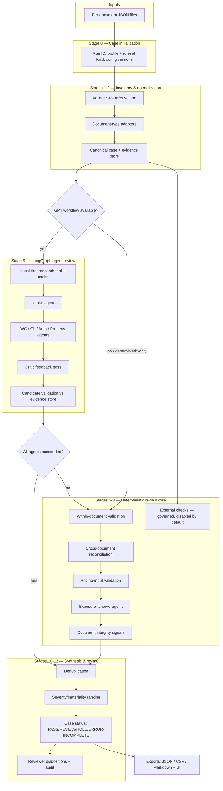

# Spectra architecture

## Overview

Spectra runs a budget-capped, evidence-constrained whole-submission GPT review
first when enabled. Deterministic rules are the fallback when GPT is disabled,
unavailable, or returns unusable structured output. Both modes retain human
review and evidence citation requirements.

## Module responsibilities

| Module | Responsibility |
|---|---|
| `app/config` | Typed env settings; secrets only via environment |
| `app/schemas` | Envelope, canonical model, Finding contract, review/stage schemas |
| `app/adapters` | Per-document-type JSON adapters + loader; unknown types preserved as `unsupported` |
| `app/normalization` | Dates, money, states, names, addresses, VINs, class codes |
| `app/catalog` | Document-type registry (with content sniffing), required-document profiles |
| `app/rules` | Rule registry (JSON rulesets), engine, taxonomy handlers |
| `app/entity_resolution` | Conservative matching + temporal alignment |
| `app/findings` | Finding builder (evidence validation), dedup, status precedence |
| `app/evidence` | Evidence-pack/export rendering |
| `app/llm` | Model gateway (OpenAI + mock), cost tracker, bounded tasks, prompt loader |
| `app/prompts` | Versioned prompt templates (front-matter IDs) |
| `app/agents` | LangGraph: intake + conditional line agents + critic feedback; SQLite checkpoints and per-agent trace events |
| `app/external_sources` | Source registry and local-first public-record/news search with persistent cache |
| `app/storage` | SQLite repository, append-only audit, disposition history |
| `app/evaluation` | Ground-truth loading, expected-vs-detected metrics |
| `app/api` | FastAPI routes + auth hook + health/ready |
| `app/cli` | `spectra` commands |
| `app/ui` | Jinja review dashboard |

## Key design decisions

1. **Evidence-linked canonical model.** Every extracted record field carries
   `field_evidence: {field -> evidence_id}`. Findings cite evidence IDs; the
   builder rejects any citation that does not resolve. Source locations are
   populated only when the input supplies provenance (`available=false`
   otherwise — never fabricated).
2. **Configuration-driven rules.** Rule metadata (IDs, versions, severity,
   tolerances, applicability) lives in `rulesets/*.json`; logic lives in
   versioned handlers. Startup validation fails when config and handlers
   disagree. Every finding records the exact rule ID/version applied.
3. **Stable finding IDs.** `sha1(submission | rule | dedup_key)` — re-running
   unchanged inputs produces identical finding IDs (idempotency) while each
   run is preserved as history.
4. **Conservative matching.** Name similarity alone is at most PARTIAL;
   unresolved entity/period alignment yields qualified findings, not
   confirmed conflicts.
5. **Status precedence.** `ERROR/INCOMPLETE > HOLD > REVIEW > PASS`. A failed
   or incomplete required check can never become PASS.
6. **LLM containment.** Structured outputs only; candidates validated against
   the evidence store; model-suggested findings are never auto-confirmed;
   deterministic-only mode is fully supported; budgets cap calls/cost.
7. **Evaluation isolation.** `evaluation/ground_truth/` is read only by the
   evaluation command and tests. The runtime path has no access to labels.

## Persistence

SQLite via `app/storage/repository.py` (runs, findings, dispositions,
audit events, token usage). This is a local-prototype store behind a narrow
interface; use a migration-ready RDBMS (e.g. PostgreSQL) for multi-user
production. Prior runs and disposition history are never overwritten —
`INSERT OR REPLACE` applies only to the same run ID.
